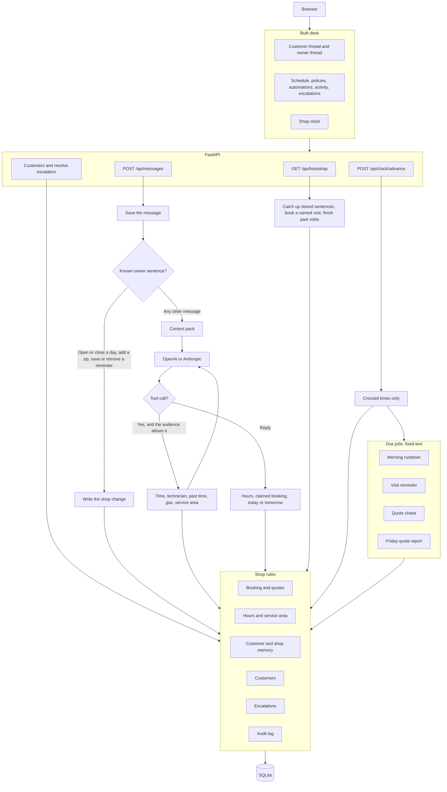
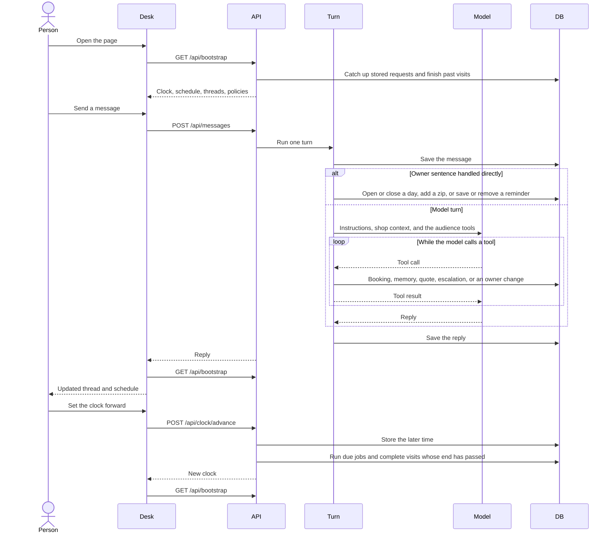

# Northside Plumbing

An AI front desk for one plumbing shop. It books visits, remembers customers, chases quiet quotes, and hands emergencies to the owner. The clock is simulated. Messages stay in the database.

## High-Level Architecture

One Python process opens SQLite, seeds the shop when the file is empty, and serves the built desk beside the API. The desk reloads `GET /api/bootstrap` after every action. A message may call the model. Moving the clock does not.



The context pack is the only shop state the model sees. It includes the clock, hours, closed days, service area, technicians, and shop memories. A customer pack also includes that person, their memories, open jobs, and recent messages. An owner pack includes open quotes, the schedule, and the owner thread.

A customer tool may remember a fact, set an address, check openings, book, quote, or escalate. An owner tool may change a setting, remember a policy, or create an automation. The customer id on a tool call comes from the thread, not from the model. A visit is booked only after the customer names a time and one technician. A start before the clock is refused, a booking that mentions gas is refused, and an address outside the service area is not booked.

Bootstrap applies owner sentences that were already stored: daily reminders, reminder removals, and service-area zips. It then books a future visit the customer already named, unless that time was cancelled, and it marks a visit completed once the clock has passed its end.

The clock moves only forward. The advance request runs each enabled job once for every scheduled time the new clock crossed, then completes past visits. Those jobs write from templates. A job that already ran for that occurrence does not run again. Each shop change also writes an audit row, which the desk shows as Activity.

## End-to-End Workflow



The clock never moves by itself and never moves backward. A booking still needs a time and a technician from the customer. A start before the clock is refused. A booking that mentions gas is refused.

## Run it

Copy the environment file and put your key in it. The key is the only paid service.

```sh
cp .env.example .env
```

`LLM_PROVIDER` is `openai` or `anthropic`. Set the matching key: `OPENAI_API_KEY` or `ANTHROPIC_API_KEY`. Model names are optional.

On a laptop:

```sh
./start.sh
```

That creates a Python 3.12 virtualenv, installs the API, builds the desk, seeds the shop the first time, and serves http://127.0.0.1:8000. The shop file is `data/northside.db`. Starting again does not rewind the clock or duplicate the sample week.

In a container:

```sh
docker compose up --build
```

Compose reads the same `.env`. The database lives in a volume, so a restart keeps the clock.

You can open the seeded shop with no key. Sending a message needs one. The morning jobs do not: they use fixed templates.

## The Clock

It moves only when a person sets it: click the time, choose a later day and time, then Set clock.

## Try it

Open http://127.0.0.1:8000 on a fresh database. The clock is Thursday, November 12, 2026, 4:00 PM Pacific, and it only moves forward. The header says Open every day. James Okonkwo is selected, with 1842 N 92nd St and gate code 4481 already on his card. Schedule, newest first, shows Luis Alvarez on Friday at 9:00 AM with Brooke Hale, Elena Vasquez's completed faucet visit on November 4, then Sam Rivera's unscheduled $149 drain quote. Policies lists Monday–Sunday 8:00 AM–5:00 PM and zips 98103, 98115, 98125, 98133, and 98177. Automations lists the 7:00 AM rundown, the 5:00 PM day-before reminder, and the quote chase. Activity is empty.

## Automated tests

```sh
cd backend && .venv/bin/pytest
cd frontend && npm test
cd frontend && npm run e2e
```

None of them call a model API. Provider tests use saved payloads. The agent and the morning jobs use a scripted model.
